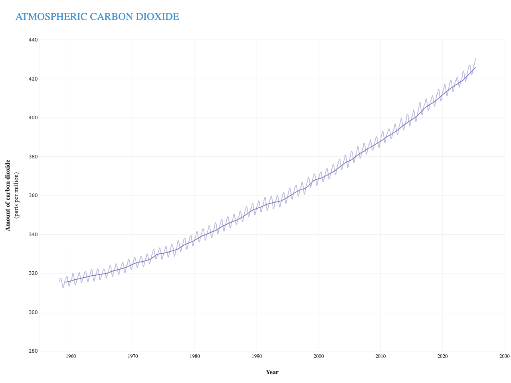

In the history of the planet, earths climate has been a dynamic entity. Over millenia, the climate would shift, giving rise 
to periods of warming, and periods of cooling. Figure 1. shows how the average global temperature has changed over the last 400 million years, demonstrating that climate is a dynamic entity. In fact, this variability is what resulted in the planet experiencing periods such 
as the ice ages. However, one important factor differentiates modern climate change from historical variability. Over the last century 
and a half, anthropological climate change has changed global mean temperatures by an amount that would historically take millenia. 

**Figure 1.** Global Mean Surface Temperatuer Over the Last 400 Million Years.[1]

The main driving force behind earths changing climate is the emissions of greenhouse gasses into the atmosphere. Amongst common greenhouse gasses are molecules like: carbon dioxide (CO2), nitrous oxide (N2O) and methane (CH4)[5]. While sourced from many processes, the main contributor to greenhouse gas emissions is the combustion of fossil fuels for energy production[6]. Similar to temperature on earth, greenhouse gas concentrations have varied historically; however, CO2 emissions post industrialization have been so high, that we have overwhelmed the earths natural cycle[7]. Shown in Figure 2., atmospheric concentrations of CO2 have grown from ~310 parts per million (ppm) in 1960, to over 420 ppm in 2024[7].

In short, human caused changes to the concentration of greenhouse gasses in the atmosphere, driven primarily by burning fossil fuels, 
is causing irreversible changes to the planet. Amongst these changes are hotter days on average, increased melting of sea ice and glaciers, increased precipitation in certain regions of the planet and others. These changes are likely to unequally negatively impact people who are already experiencing poverty, widening the global wealth gap. In an attempt to combat climate change, countries from around the planet have come together, at events such as COP30 in Brazil, where they discuss efforts to lower emissions and slow climate change. One important document to come out of the COP meetins was the Paris Accord at COP21 in 2015. 

  

