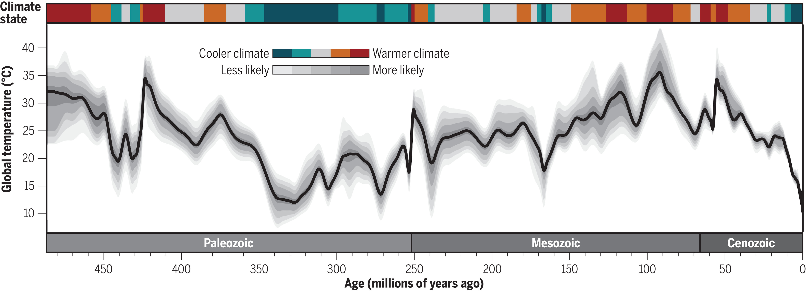

In the history of the planet, earths climate has been a dynamic entity. Over millenia, the climate would shift, giving rise 
to periods of warming, and periods of cooling. This is how the planet experienced periods such 
as the ice ages. 

**Figure 1.** Global Mean Surface Temperatuer Over the Last 400 Million Years. [1]
