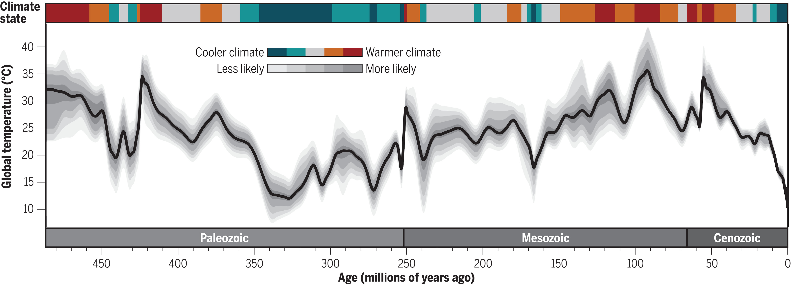

**A Story of Green Chemistry**

Green chemistry refers to a field of chemistry that aims to minimize use of harmful chemicals, while promoting more sustainable 
chemical practices. Made up of twelve core principles, shown in Figure 1., green chemistry serves as a good lens through which 
to understand the mitigation potential of chemistry. To take this a step further, we will analyze the mitigation potential of green chemistry through the lens of Kirsten Aasen, a PhD candidate in the Buckley group. 

**Figure 1.** The 12 principles of green chemistry[4].

**Ball Milling for Solventless Chemistry**

